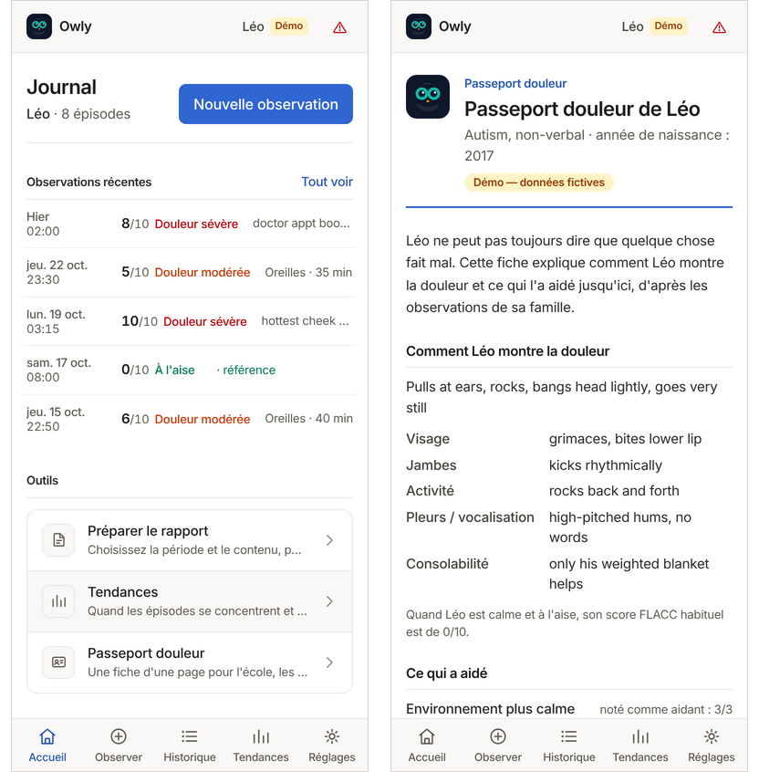

# 🦉 Owly

[](https://github.com/titoude/owly/actions/workflows/ci.yml)
[](https://titoude.github.io/owly/)
[](LICENSE)

**Un journal de la douleur privé et hors ligne, pour les enfants qui ne peuvent pas dire qu'ils ont mal.**

Owly aide les parents d'enfants non verbaux (autisme sévère, paralysie cérébrale, polyhandicap) à noter en moins d'une minute ce qu'ils observent et à repérer des tendances. Ils peuvent ensuite le partager sous deux formes : un rapport pour le médecin, et un **passeport douleur** d'une page pour toutes les autres personnes qui s'occupent de l'enfant.

**[Essayer la démo en ligne →](https://titoude.github.io/owly/)** Choisissez le français sur l'écran d'accueil, puis *Explorer la démo* pour charger Léo, un enfant fictif de 9 ans avec trois semaines d'observations. Rien de ce que vous saisissez ne quitte votre appareil.



Conçu pour [Opethon](https://opethon.com/), parcours Accessibilité et inclusion · [English version](README.md)

---

## Le problème

Un enfant qui ne parle pas a mal quand même. Les parents apprennent à lire une grimace, un balancement, une immobilité soudaine. Mais quand le médecin demande *« à quelle fréquence ? quelle intensité ? qu'est-ce qui soulage ? »*, ils n'ont que leur mémoire et leur inquiétude. Chez ces enfants, la douleur est connue pour être **sous-reconnue et sous-traitée**, et chaque consultation repart de zéro.

Le même manque existe hors du cabinet médical. L'enseignante, l'accueil de répit, les grands-parents ou l'infirmière des urgences ne savent pas que *cet* enfant devient immobile quand il a mal, ni qu'une pièce calme et sombre l'apaise.

Les outils commerciaux existent, mais pour les établissements. PainChek®, le produit clinique de référence, est vendu sous licence aux structures et aux soignants. Son application pour parents ne couvre que les bébés de 1 à 12 mois. Owly est un journal pour les aidants, pas un outil de diagnostic. Il fonctionne en local et hors ligne, sans compte, et il est gratuit.

## Ce que fait Owly

- **Observations guidées.** L'échelle [FLACC](https://en.wikipedia.org/wiki/FLACC_scale) (visage, jambes, activité, pleurs, consolabilité) est une échelle d'observation publiée pour les patients qui ne peuvent pas s'auto-évaluer.
- **Adapté à l'enfant.** Les descripteurs individuels rFLACC (« comment *votre* enfant le montre ») s'affichent dans chaque étape.
- **Calme ou épisode.** Owly note aussi les moments calmes, pour pouvoir mesurer ce qui est « inhabituel ».
- **Carte du corps, interventions, notes.** Où ça pourrait faire mal, ce que vous avez essayé, et si cela a aidé.
- **Tendances.** Heures de la journée, zones récurrentes, ce qui a été noté comme aidant. Ce sont des pistes à discuter avec le médecin, pas des causes démontrées.
- **Rapport pour le médecin.** Un PDF généré sur l'appareil, et le même rapport **en page web accessible**, avec des titres, un tableau de données légendé et l'impression.
- **Passeport douleur.** Une page imprimable pour l'école, l'accueil de répit, la famille et les urgences :
  - comment l'enfant montre la douleur ;
  - ce qui l'a aidé ;
  - que faire ;
  - quand appeler les secours.

  Il ne mentionne jamais de médicament.
- **Mode nuit.** Un thème sombre pour veiller un enfant dans une chambre plongée dans le noir. Les sept écrans principaux sont audités en contraste dans ce mode, et l'impression reste toujours claire.
- **Hors ligne.** Application installable (PWA) en 9 langues, dont l'arabe (de droite à gauche).

## Visite en trois minutes

1. **Tendances.** Les épisodes de Léo surviennent la nuit et concernent les oreilles. Le médicament et un environnement plus calme ont été notés comme aidants.
2. **Rapport.** Ajoutez une question pour le pédiatre, puis :
   - **Générer le rapport PDF** produit la page à remettre ;
   - **Lire le rapport à l'écran** affiche le même contenu en page web.
3. **Passeport douleur.** Accueil → *Passeport douleur* → *Imprimer ou enregistrer en PDF*. Il tient sur une page A4.
4. **Mode nuit.** Réglages → Apparence → *Nuit*.
5. **Observer.** Saisissez une observation avec l'assistant en 8 étapes. Une saisie interrompue est gardée en brouillon et survit au rechargement.

## Accessibilité

Owly est conçu pour des aidants épuisés, qui tiennent souvent l'enfant d'une main, dans le noir. L'accessibilité de l'application est testée à chaque pull request :

| Vérification | Résultat | Commande |
|---|---|---|
| axe-core, WCAG 2.2 A/AA + bonnes pratiques | **43 scénarios, 0 violation** : chaque page, chaque étape de saisie, les états d'erreur et vides, le français, l'arabe (RTL) et 7 écrans en mode nuit | `node scripts/a11y/audit.mjs` |
| Clavier | 17 vérifications : groupes radio, lien d'évitement, focus des dialogues | `npm run e2e:keys` |
| Reflow | Aucun débordement horizontal de 320 à 1440 px, en anglais, en allemand et en arabe | `node e2e/overflow-check.mjs` |
| Impression | Le passeport et le rapport à l'écran tiennent chacun sur une page A4, sans l'interface | `npm run e2e:features` |

Le PDF est un document visuel. Le rapport à l'écran en est l'équivalent accessible, avec les mêmes chiffres issus du même code (`src/summary.ts`).

**Pas encore vérifié :**
- un vrai passage au lecteur d'écran (NVDA, VoiceOver, TalkBack) ;
- la structure balisée du PDF ;
- des tests avec des aidants et des soignants.

Ces points sont suivis dans [titoude/owly#4](https://github.com/titoude/owly/issues/4).

## Vie privée par construction

Toutes les données restent dans le navigateur (IndexedDB). Il n'y a ni compte, ni serveur, ni statistiques, ni cloud. Le journal n'est jamais transmis.

Options :
- un code PIN de verrouillage ;
- l'export et l'import d'une sauvegarde JSON ;
- la suppression de toutes les données en un geste.

Les lignes de contact du passeport n'existent que sur papier : Owly n'enregistre aucun numéro de téléphone.

## Démarrer

```bash
npm ci --ignore-scripts
npm run dev               # http://localhost:5173
```

Production : `npm run build` produit `dist/`, un site entièrement statique. Pour le servir depuis un sous-chemin, définissez `OWLY_BASE=/owly/`. Le workflow *Live demo* publie `main` sur GitHub Pages. Pour l'activer : *Settings → Pages → Source : GitHub Actions*.

Les commandes de vérification complètes sont dans le [README anglais](README.md#verify-the-release).

## Échelle clinique et licence

Owly est un journal d'observation : il n'établit pas de diagnostic et n'est pas un dispositif médical. En cas de doute, appelez un médecin.

L'échelle FLACC (Merkel et al., 1997) et sa version individualisée rFLACC (Malviya et al., 2006) appartiennent à leurs auteurs (Université du Michigan). La licence MIT d'Owly couvre son code, pas l'échelle. Les conditions de diffusion et de traduction sont en cours de clarification ([titoude/owly#3](https://github.com/titoude/owly/issues/3)). La traduction française de l'échelle provient d'une version existante, signalée pour relecture.

Développé avec l'aide d'outils d'IA (Devin, Claude Code).
