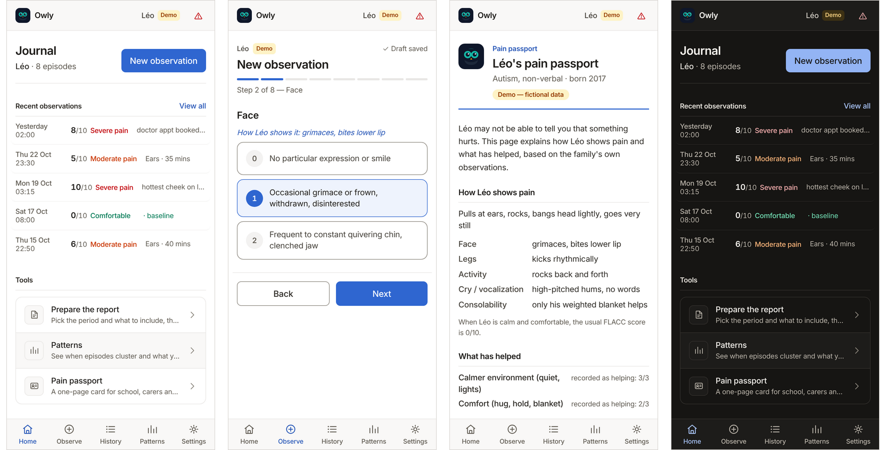
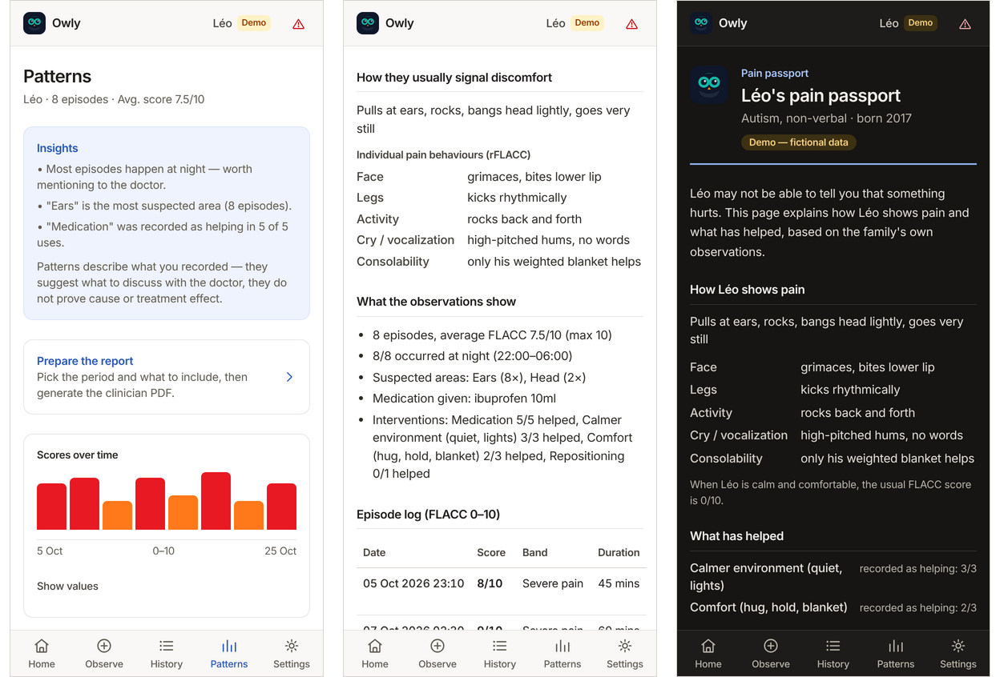
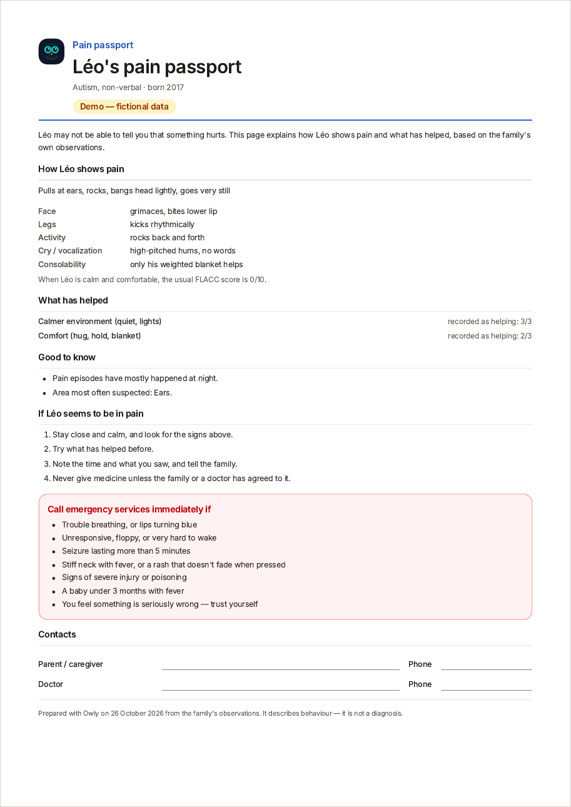

# 🦉 Owly

[](https://github.com/titoude/owly/actions/workflows/ci.yml)
[](https://titoude.github.io/owly/)
[](LICENSE)

**A private, offline pain journal for children who can't say it hurts.**

Owly helps parents of nonverbal children (severe autism, cerebral palsy, complex disabilities) record what they see in under a minute and spot patterns. They can then share it in two forms: a report for the doctor, and a one-page **pain passport** for everyone else who looks after their child.

**[Try the live demo →](https://titoude.github.io/owly/)** Tap *Explore the demo instead* to load Léo, a fictional 9-year-old with three weeks of observations. Nothing you type leaves your device.



Built for [Opethon](https://opethon.com/), Accessibility & Inclusion track · [Version française](README.fr.md)

---

## The problem

A child who can't speak still feels pain. Parents of nonverbal kids learn to read grimaces, rocking and sudden stillness. But when the doctor asks *"how often? how bad? what helps?"*, all they have is memory and worry. Pain in this population is documented to be **under-recognized and under-treated**, and every appointment starts from zero.

The same gap exists outside the doctor's office. The teacher, the respite carer, the grandparent and the ER nurse don't know that *this* child goes very still when it hurts, or that a dark, quiet room settles him.

Commercial tools exist, but they're built for institutions. PainChek®, the leading clinical product, is licensed to facilities and clinicians. Its parent-facing app covers only infants aged 1–12 months ([PainChek Infant](https://www.painchek.com/use-cases/infant-for-parents/)). Owly is a journal for caregivers, not a diagnostic tool. It is local-first, works offline, needs no account and is free.

## What Owly does

- **Guided observations.** [FLACC](https://en.wikipedia.org/wiki/FLACC_scale) scoring (Face, Legs, Activity, Cry, Consolability), a published observational scale for patients who can't self-report.
- **Personalized to the child.** Individual rFLACC descriptors ("how *your* child shows it") appear inside each scoring step.
- **Baseline vs. episode.** Calm moments are recorded too, so "different from usual" becomes measurable.
- **Body map, interventions, notes.** Where it might hurt, what you tried, and whether it helped.
- **Patterns.** Time-of-day clusters, recurring areas and what was recorded as helping. These suggest what to discuss; they don't claim cause.
- **Doctor report.** A PDF built on the device, and the same report **as an accessible web page**, with headings, a captioned data table and print support.
- **Pain passport.** One printable page for school, respite care, family and the ER:
  - how the child shows pain;
  - what has helped;
  - what to do;
  - when to call emergency services.

  It never lists medication.
- **Night mode.** A dark palette for checking on a child in a dark room. Seven main screens are re-audited for contrast in night mode, and printing always uses the light palette.
- **Works offline.** Installable PWA in 9 languages: EN, FR, ES, PT, DE, IT, AR (right-to-left), HI and 中文.

## A three-minute tour



1. **Patterns.** Léo's episodes cluster at night and point to his ears. Medication and a quieter environment were recorded as helping.
2. **Report.** Add a question for the pediatrician, then:
   - **Generate PDF report** produces the page you hand over;
   - **Read the report on screen** shows the same content as a web page.
3. **Pain passport.** Go to Home → *Pain passport* → *Print or save as PDF*. It fits on one A4 page.
4. **Night mode.** Settings → Appearance → *Night*.
5. **Observe.** Record a new observation through the 8-step wizard. A half-finished observation is saved as a draft that survives a reload.

<details>
<summary>The printed pain passport (A4, from the demo)</summary>



</details>

## Accessibility

Owly is built for caregivers who are exhausted, holding a child with one hand, and often in the dark. Its own accessibility is tested on every pull request:

| Check | Result | How |
|---|---|---|
| axe-core, WCAG 2.2 A/AA + best practice | **43 scenarios, 0 violations**: every route, every wizard step, error and empty states, French, Arabic (RTL), and 7 screens in night mode | `node scripts/a11y/audit.mjs` |
| Keyboard | 17 checks: radio groups, skip link, dialog focus trap and restore | `npm run e2e:keys` |
| Reflow | No horizontal overflow at 320 / 390 / 768 / 1024 / 1440 px in English, German and Arabic | `node e2e/overflow-check.mjs` |
| Print | Passport and on-screen report print on one A4 page each, without the app chrome | `npm run e2e:features` |

The PDF is a visual document. The on-screen report is its accessible equivalent, with the same numbers from the same code (`src/summary.ts`).

**Not yet verified:**
- a real screen-reader pass (NVDA, VoiceOver, TalkBack);
- tagged-PDF structure;
- testing with caregivers and clinicians.

These are tracked in [titoude/owly#4](https://github.com/titoude/owly/issues/4) and in [docs/accessibility-evidence.md](docs/accessibility-evidence.md).

## Privacy by architecture

Owly is **local-first**: every observation lives in IndexedDB on your device. There is no account, server, analytics or cloud, and journal data is never transmitted. The only network traffic is same-origin asset fetches and service-worker update checks, which you can verify in dev tools. All assets, including the PDF fonts, are bundled and precached.

Optional features:
- a PIN lock;
- full JSON export and import;
- one-tap deletion of all data.

The passport's contact lines exist only on paper, so Owly never stores phone numbers. See [docs/privacy.md](docs/privacy.md).

## Quick start

Requires **Node.js ^20.19 or ≥22.12** (Vite 8's requirement). Built and tested on Node 22 and 24.

```bash
npm ci --ignore-scripts   # frozen install
npm run dev               # http://localhost:5173
```

Then press **"Explore the demo instead"** on the welcome screen (or *Load demo data* in Settings).

### Production and live demo

```bash
npm run build      # → dist/ (fully static, no backend, ever)
npm run preview    # serve the production build
```

`dist/` runs on any static host. To serve it from a sub-path, set `OWLY_BASE`, for example `OWLY_BASE=/owly/ npm run build`. The [Live demo workflow](.github/workflows/pages.yml) publishes `main` to GitHub Pages. To enable it, go to *Settings → Pages → Source: GitHub Actions*.

## Verify the release

```bash
npm ci --ignore-scripts
npm run typecheck && npm run lint && npm run i18n:check
npm test                 # 44 unit and integration tests
npm run build
npx playwright install chromium
```

With `npm run preview -- --host 127.0.0.1 --port 4173` running:

```bash
npm run e2e              # 9 golden-path checks
npm run e2e:full         # 44 flows: PDF, PIN, import/export, drafts, demo data…
npm run e2e:keys         # 17 keyboard checks
npm run e2e:features     # 33 checks: pain passport, on-screen report, print, night mode, RTL
node e2e/offline.mjs     # offline cold reload + PDF bytes
node scripts/a11y/audit.mjs --out a11y-audit/local
```

The accessibility audit fails if any declared route or state is unverified, or if an automated rule could not run. A pass is not a claim of full WCAG conformance. See [docs/evidence-matrix.md](docs/evidence-matrix.md) for what each claim rests on.

## Tech

- React 19, TypeScript (strict), Vite 8, Tailwind v4
- Dexie (IndexedDB) for local-first storage
- pdf-lib with fontkit and bidi-js: on-device PDF with Arabic, Devanagari and CJK shaping
- vite-plugin-pwa: offline and installable
- i18next: 9 languages, with plural rules checked per locale
- Vitest, Testing Library and fake-indexeddb; Playwright end-to-end tests against the production build; axe-core over a declared route/state manifest; oxlint and `tsc -b` in CI

## Project layout

```
src/
  summary.ts       one source of truth for the numbers (PDF, on-screen report, passport, patterns)
  report.ts        pdf-lib doctor report builder
  flacc.ts         FLACC descriptors, bands, body zones, intervention types
  db.ts            Dexie schema (children, observations, settings)
  theme.ts         light / night / automatic appearance
  demo.ts          seed data for "Léo" (fictional demo child)
  export.ts        JSON backup/restore/wipe
  pin.ts           SHA-256 PIN hashing for the app lock
  pages/           Onboarding, Observe (8-step wizard), History, Patterns, Report,
                   ReportView, Passport, Settings, RedFlags, ChildForm, LockScreen
  components/      FlaccPicker, BodyMap, ScoreBadge, ObsRow, icons
  test/            unit + integration tests
e2e/               Playwright suites (smoke, full, keyboard, features, offline, overflow)
scripts/a11y/      axe audit + the manifest of every audited route and state
```

## Roadmap

- Optional end-to-end encrypted sync across a family's devices (still no server we run)
- FHIR export for EHR integration
- Sleep and feeding context fields
- Native-speaker review of every locale

## Clinical scale and licensing

Owly is an observation journal. It records what caregivers observe and does not diagnose. It has not undergone any medical-device assessment, and the red-flags screen exists for a reason: when in doubt, call a doctor.

The English FLACC descriptors follow the published instrument (Merkel et al., 1997). The individualized descriptors follow rFLACC (Malviya et al., 2006). FLACC is owned by the University of Michigan, and Owly's MIT license covers Owly's code, not the scale. Redistribution and translation terms are being clarified in [titoude/owly#3](https://github.com/titoude/owly/issues/3).

Until then, the scale wording ships in English in every locale except French. French uses an existing translation that is marked for review ([docs/i18n-review.md](docs/i18n-review.md)).

## Credits and notices

- Built with AI assistance (Devin, Claude Code). Review status is tracked in `docs/`.
- **Noto fonts** (Sans, Arabic, Devanagari, SC subset) are vendored in `src/assets/fonts/` under the SIL Open Font License 1.1 (`src/assets/fonts/OFL.txt`). The SC subset covers the 8,105-character Table of General Standard Chinese Characters plus ASCII and CJK punctuation, so the PDF can render Chinese offline. If a record contains a character no bundled font can draw, PDF generation stops with an error naming it, rather than printing empty boxes.
- **Runtime libraries:** pdf-lib, @pdf-lib/fontkit, bidi-js and regenerator-runtime (MIT); React, Dexie and i18next under their own licenses.
- **Dev tools:** axe-core (MPL-2.0) and Playwright (Apache-2.0).

## Docs

- [docs/demo-script.md](docs/demo-script.md): 3-minute walkthrough
- [docs/privacy.md](docs/privacy.md): what is stored where, and the limits
- [docs/accessibility-statement.md](docs/accessibility-statement.md) and [docs/accessibility-evidence.md](docs/accessibility-evidence.md): what's verified and what isn't
- [docs/evidence-matrix.md](docs/evidence-matrix.md): every claim mapped to the test that backs it
- [CONTRIBUTING.md](CONTRIBUTING.md) · [SECURITY.md](SECURITY.md)
